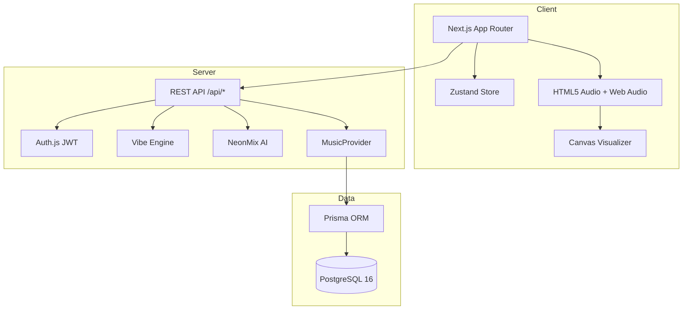
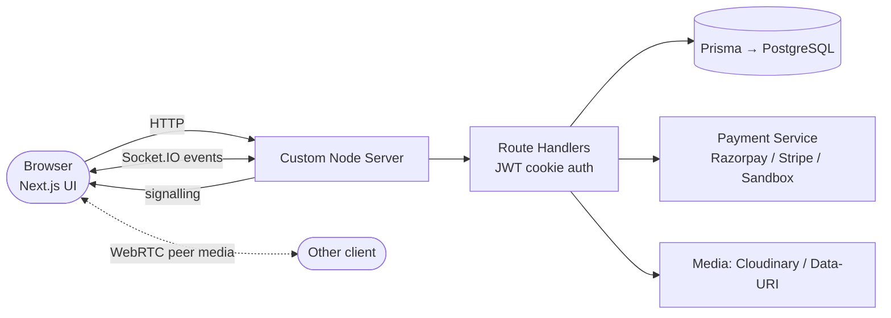

<div align="center">

<a href="https://vybeon.onrender.com/" title="Open Vybeon live">
  
</a>

<br/>


<br/>


<br/>

<a href="https://vybeon.onrender.com/"></a>
<a href="https://www.linkedin.com/in/prasenjit-sahoo18/"></a>
<a href="mailto:mukeshsahoo902@gmail.com"></a>


</div>

<br/>

```text
┌─────────────────────────── DEV.PROFILE ───────────────────────────┐
│  NAME       Prasenjit Sahoo                                        │
│  STUDYING   B.Tech CSE — ITER, SOA University, Bhubaneswar         │
│  LANGUAGES  Python · Java · C++ · TypeScript · JavaScript          │
│  SHIPPED    Vybeon · VibeChat · ShowPulse · CodeBuzz49 · foodiez   │
│  PRACTISING LeetCode · Competitive Programming · System Design     │
│  PRINCIPLE  A deployed product beats a perfect localhost.          │
└────────────────────────────────────────────────────────────────────┘
```

<br/>

<div align="center">

# ⚡ FLAGSHIP BUILDS

</div>

## 🎧 VYBEON &nbsp;·&nbsp; *Where every vibe comes alive*

> A futuristic music-streaming platform with a mood-driven **Vibe Engine**, an in-house **NeonMix AI** assistant, **Music DNA** analytics and a real-time **Web Audio visualizer** — wrapped in a Radium Neon design system.

<table>
<tr>
<td width="62%" valign="top">

```ts
stack: {
  app:      "Next.js 14 (App Router) · React 18 · TypeScript",
  ui:       "Tailwind CSS · Zustand · Recharts",
  auth:     "Auth.js v5 (JWT) · Zod validation",
  data:     "Prisma 5 · PostgreSQL 16",
  audio:    "HTML5 Audio + Web Audio Analyser",
  deploy:   "Render Blueprint (render.yaml)",
  quality:  "Vitest · strict TypeScript · /api/health",
}
```

</td>
<td width="38%" valign="top">

**What's inside**

🔮 Vibe Engine mood → playlist
🤖 NeonMix AI music assistant
📊 Music DNA listening analytics
📡 Neon Radio endless stations
🔊 Live spectrum visualizer
🏆 Achievement unlocks
⌨️ Full keyboard shortcuts

</td>
</tr>
</table>

[](https://vybeon.onrender.com/) [](https://github.com/Prasenjit-Sahoo18/Vybeon)

<details>
<summary><b>🗺️ Vybeon architecture (click to expand)</b></summary>



</details>

<br/>

## 💬 VIBECHAT &nbsp;·&nbsp; *Real-time social communication platform*

> Instant messaging with **voice & video calls (WebRTC)**, 24-hour **music status stories**, **in-chat payments** and an **AI copilot** — all running on a unified single-port Next.js + Socket.IO server.

<table>
<tr>
<td width="62%" valign="top">

```ts
stack: {
  app:       "Next.js 14 · React 18 · TypeScript · Tailwind",
  realtime:  "Node HTTP server + Socket.IO (single port)",
  calling:   "WebRTC MediaStream — voice & video",
  data:      "Prisma · PostgreSQL (SQLite locally, auto-switch)",
  auth:      "JWT in HTTP-only cookies · bcryptjs · Zod",
  payments:  "Razorpay / Stripe / sandbox abstraction",
  media:     "File API · Cloudinary adapter",
  deploy:    "Docker · Render blueprint · Fly.io config",
}
```

</td>
<td width="38%" valign="top">

**What's inside**

⚡ Typing, read receipts, reactions
📞 Voice & video calling
💸 Peer-to-peer wallet payments
🎵 Stories with music
🤖 AI copilot
📥 One-click media downloads
📷 Avatar upload from device

</td>
</tr>
</table>

[](https://github.com/Prasenjit-Sahoo18/Vibe_Chat)

<details>
<summary><b>🗺️ VibeChat request flow (click to expand)</b></summary>



</details>

<br/>

<div align="center">

# 🧩 MORE SHIPPED PROJECTS

</div>

<table>
<tr>
<td width="50%" valign="top">

### 🎬 ShowPulse
`Discover → Showtimes → Seat Lock → Checkout → QR Ticket`

10-minute temporary seat holds, coupon engine, JWT auth, QR tickets, admin analytics.

`React` `TypeScript` `Node` `Express` `Prisma` `PostgreSQL`

[▶ Live](https://cinepulse-7ajb.onrender.com) · [⌥ Code](https://github.com/Prasenjit-Sahoo18/ShowPulse)

</td>
<td width="50%" valign="top">

### 🧠 CodeBuzz49
`Practice → AI Hints → Execute → Proctor → Assess`

Gemini-powered hints, remote code execution, OpenCV + MediaPipe camera proctoring, premium plans.

`Django` `PostgreSQL` `Gemini API` `OpenCV`

[▶ Live](https://codebuzz-master.onrender.com/) · [⌥ Code](https://github.com/Prasenjit-Sahoo18/CodeBuzz49)

</td>
</tr>
</table>

<div align="center">

<a href="https://github.com/Prasenjit-Sahoo18/foodiez"></a>
<a href="https://github.com/Prasenjit-Sahoo18/Vybeon"></a>

</div>

<br/>

<div align="center">

# 🛠️ TECH STACK


<br/>

<br/>

<br/>


<br/>


</div>

<br/>

<div align="center">

# 🧭 LEVEL MAP

</div>

| 🟢 Daily driver | 🟡 Growing | 🟣 Next unlock |
|:--|:--|:--|
| Next.js · React · TypeScript · Node | Django · WebRTC · Socket.IO at scale | System Design (HLD / LLD) |
| Prisma · PostgreSQL · REST APIs | Docker · Render / Fly.io | AWS · CI/CD pipelines |
| Python · Java · C++ | AI API integration | AI Engineering · MLOps |
| Git · DSA on LeetCode | Competitive Programming | gRPC · Kafka · Redis |

<br/>

<div align="center">

# 📡 GITHUB SIGNAL


<br/>

<picture>
  <source media="(prefers-color-scheme: dark)" srcset="https://raw.githubusercontent.com/Prasenjit-Sahoo18/Prasenjit-Sahoo18/output/github-snake-dark.svg">
  <source media="(prefers-color-scheme: light)" srcset="https://raw.githubusercontent.com/Prasenjit-Sahoo18/Prasenjit-Sahoo18/output/github-snake.svg">
  
</picture>

<br/><br/>

```
build → break → learn → ship → repeat
```

**Open to internships, collaborations and good conversations about code.**


</div>
